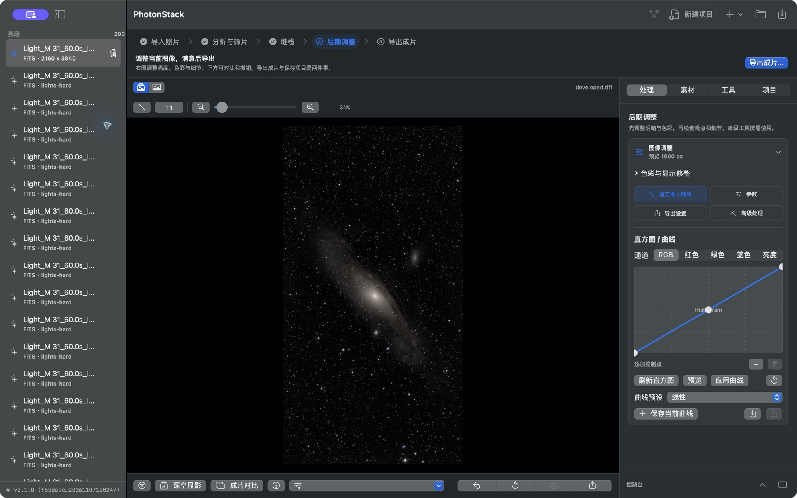
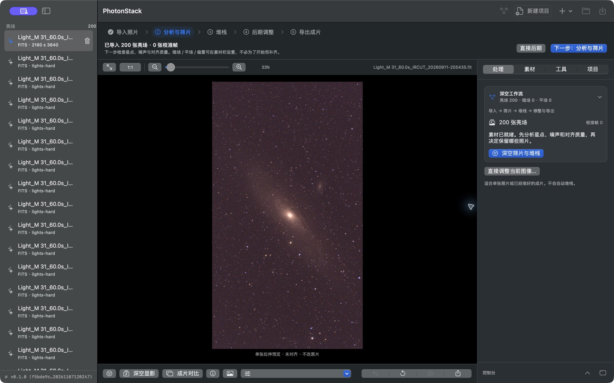
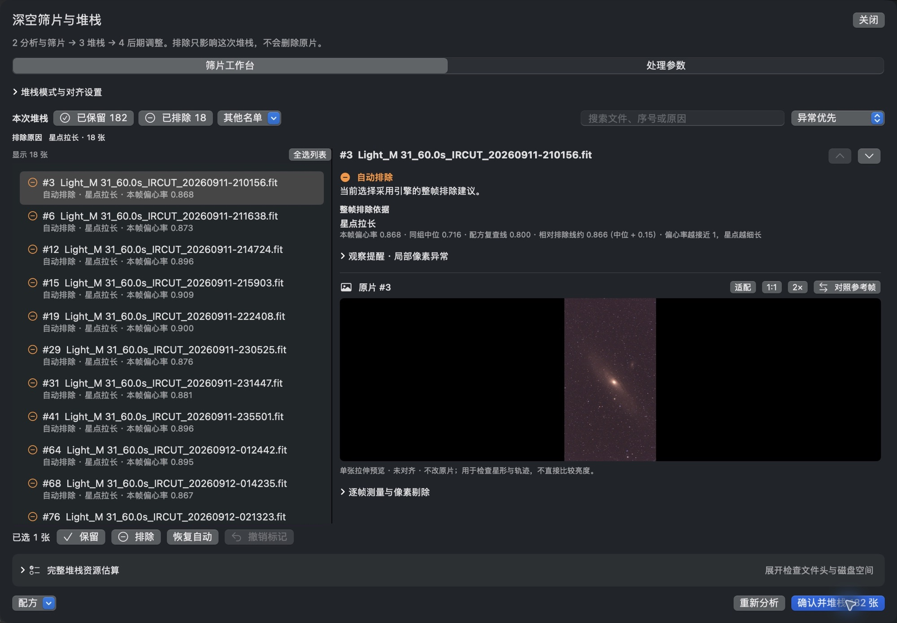
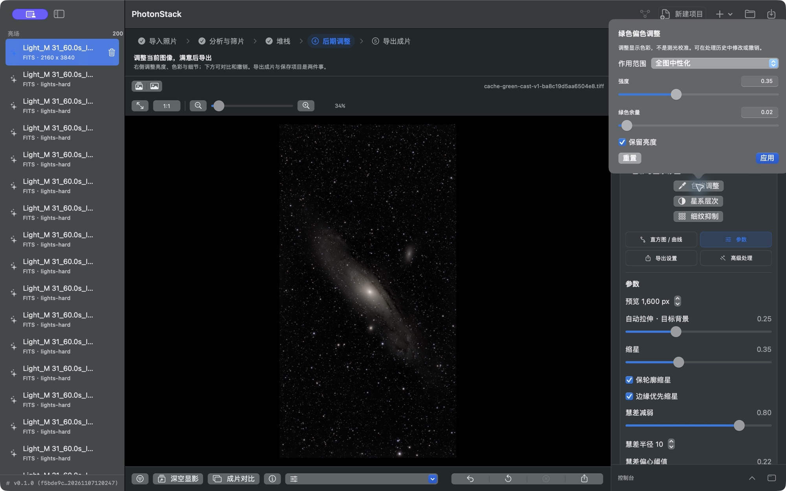
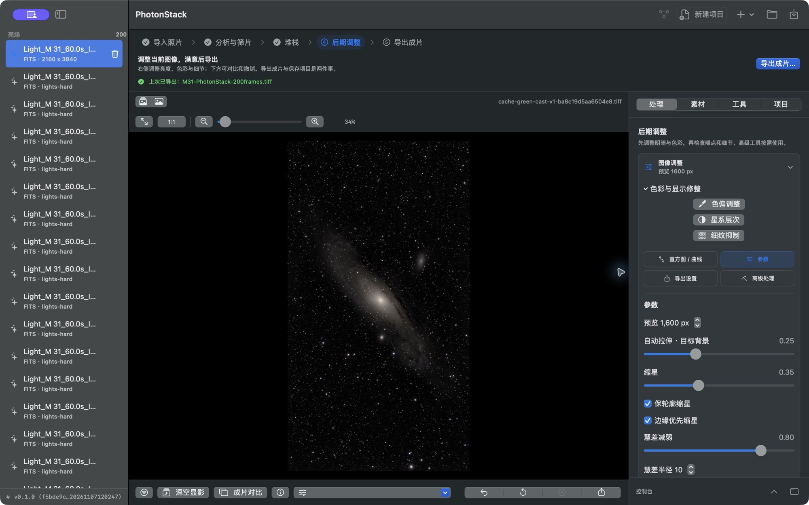
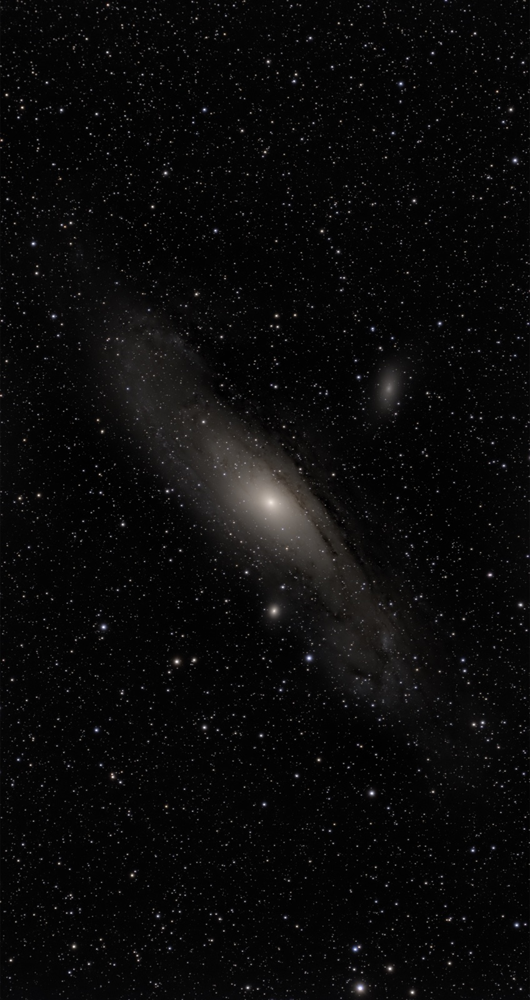

# PhotonStack

PhotonStack is a macOS-first astrophotography workspace for taking a capture
sequence from source frames to a reviewable, reproducible final image. It pairs
a native desktop workflow with a shared C++20 processing engine and a CLI for
automation.

## What it does

- Imports RAW, ProRAW, FITS, TIFF, JPEG, PNG, and HEIF without modifying the
  source files.
- Measures star shape, noise, registration quality, and local anomalies before
  stacking.
- Explains every automatic frame exclusion with the filename, metric, group
  median, and threshold; users can keep, exclude, or restore automatic choices.
- Supports calibration, registration, normalization, Winsorized and other
  stacking modes, drizzle, mosaics, star detection, masks, and star reduction.
- Provides deep-sky development, histogram and curves, background and color
  correction, contrast, denoise, sharpen, deconvolution, and artifact controls.
- Keeps processing history and exports the final image separately from the
  editable project.
- Exposes the core processing pipeline through the macOS app and CLI for
  repeatable workflows.

## Real M31 workflow: 200 source frames

The walkthrough below was completed in the release app with 200 evenly sampled
M31 FITS light frames. No calibration frames were added for this demonstration.
PhotonStack analyzed all 200 files, automatically excluded 18 frames with
elongated stars, stacked the remaining 182, applied a conservative
luminance-preserving color-neutralization pass, and exported a 1928 × 3638 TIFF.

### 1. Import and inspect

The workspace makes the material count and next action visible immediately.
The preview is a non-destructive stretch of one source frame, not a processed
replacement for the original.

### 2. Analyze and review exclusions

Screening is designed to be auditable. In this run, the excluded-frame list
shows the exact cause (`星点拉长`, elongated stars), each frame's eccentricity,
the group median, and the recipe threshold. Exclusion affects only the current
stack and never deletes source files.

### 3. Register and stack

The selected 182 frames were registered and combined with Winsorized rejection.
After completion, PhotonStack retains the 200-frame source list and the 18-frame
exclusion record so the result can be reviewed or reprocessed.

### 4. Develop and correct color

Finishing tools are integrated into the same workspace. This example uses a
light full-image neutralization (`0.35` strength, `0.02` green allowance) while
preserving luminance. Curves, galaxy tonal separation, star control, denoise,
sharpen, and advanced processing remain available for further work.

### 5. Export the final image

Export is an explicit final step and reports the completed filename in the
workflow. PhotonStack also writes processing metadata beside the image for
traceability.

### Final image

> This is a real end-to-end product walkthrough, not a calibrated scientific
> benchmark. Capture conditions, calibration frames, recipe choices, hardware,
> and output resolution all affect quality and processing time.

## Architecture

- **Core engine:** shared C++20 image-processing and astronomy pipeline.
- **macOS app:** native project, review, processing, history, and export
  experience.
- **CLI:** scriptable inspection, conversion, workflow, FITS, and artifact
  operations.
- **Project model:** source references, recipes, review decisions, generated
  artifacts, and edits remain separate from original media.
- **Tooling:** tests, build scripts, packaging helpers, and documentation live
  in the same repository.

## Documentation

Start with [`docs/README.md`](docs/README.md) for the documentation map, build
instructions, command references, and design notes.

## License

PhotonStack is licensed under the Apache License 2.0. See [`LICENSE`](LICENSE)
for details.
