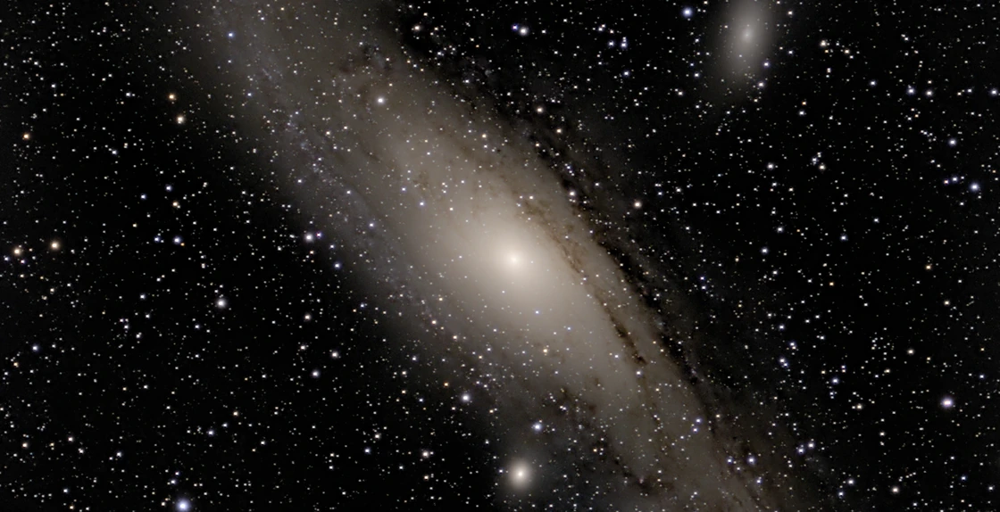
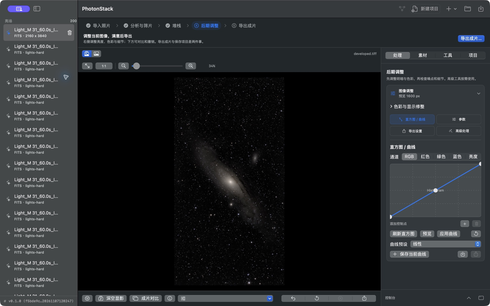
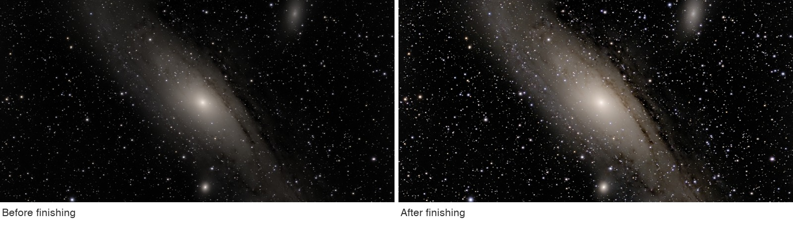
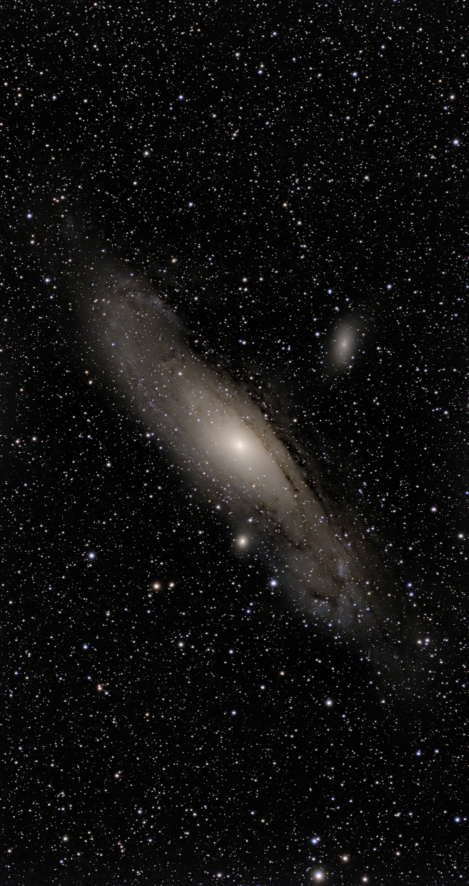
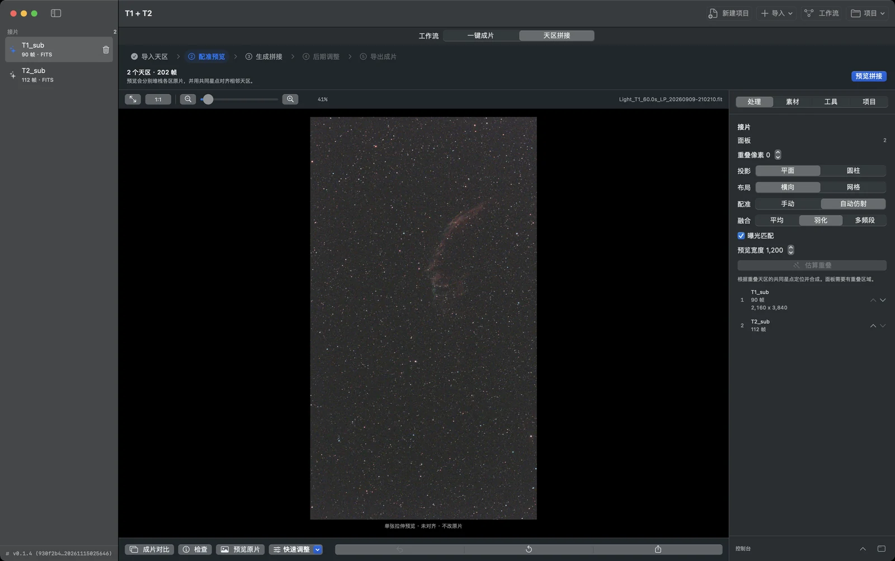
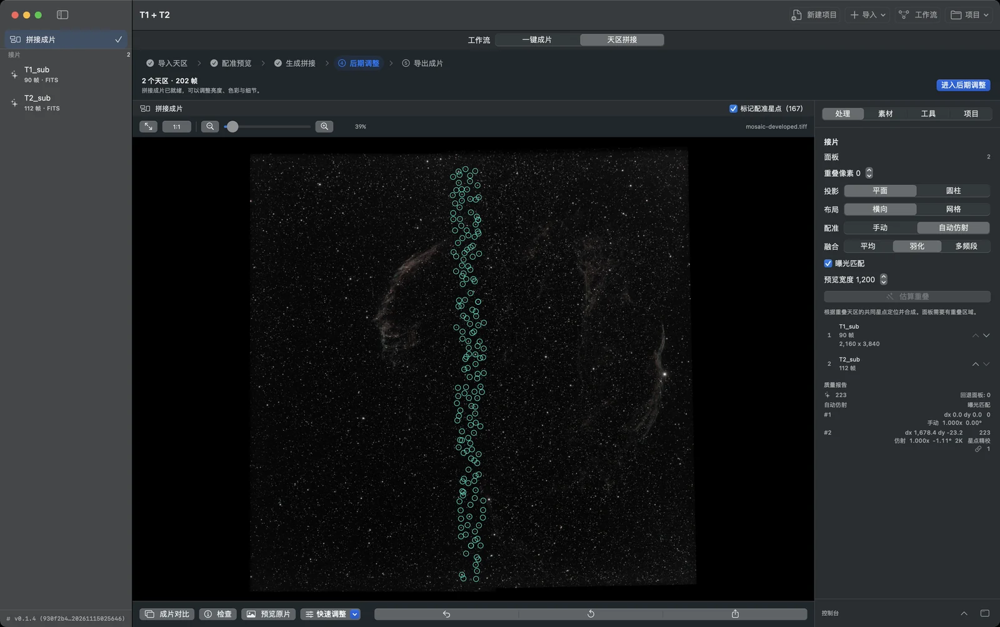
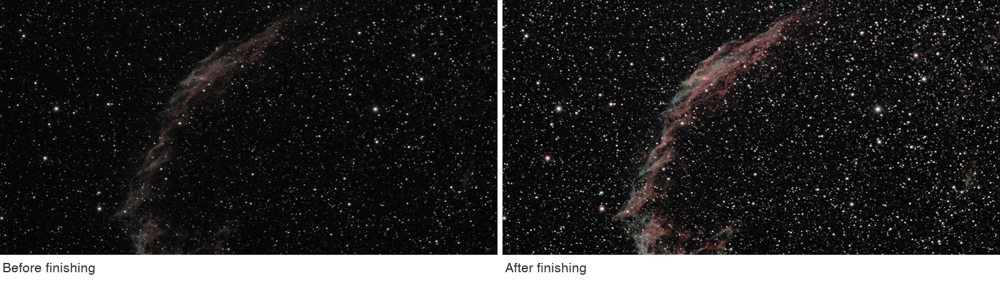
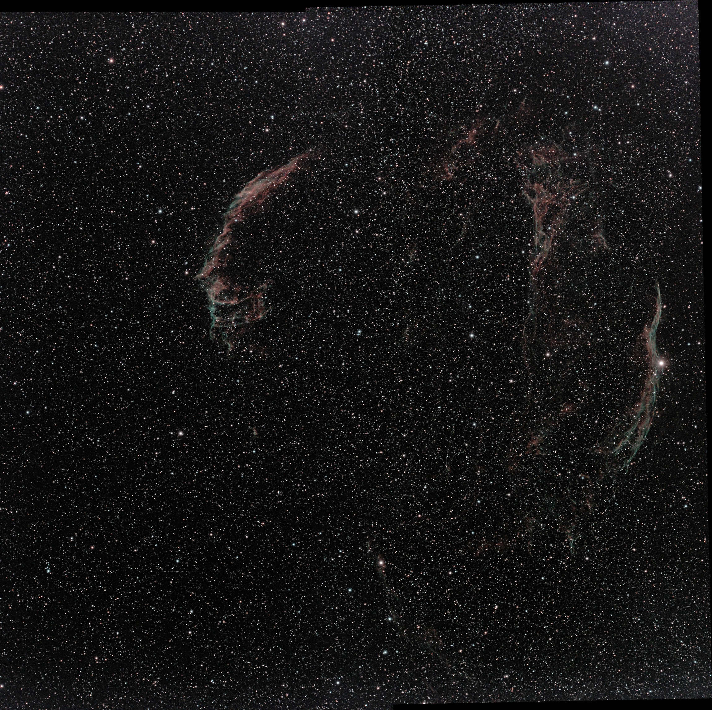

# PhotonStack

PhotonStack is a macOS-first astrophotography workspace for taking a capture
sequence from source frames to a reviewable, reproducible final image. It pairs
a native desktop workflow with a shared C++20 processing engine and a CLI for
automation.

Compare the same patch of sky before and after finishing:
[M31 dust lanes](https://astro.ruida.li/?workflow=m31&step=finish#process) ·
[Veil Nebula mosaic](https://astro.ruida.li/?workflow=mosaic&step=finish#process).

## What it does

- Imports RAW, ProRAW, FITS, TIFF, JPEG, PNG, and HEIF without modifying the
  source files.
- Measures star shape, noise, registration quality, and local anomalies before
  stacking.
- Explains every automatic frame exclusion with the filename, metric, group
  median, and threshold; users can keep, exclude, or restore automatic choices.
- Supports calibration, registration, normalization, Winsorized and other
  stacking modes, drizzle, star detection, masks, and star reduction.
- Builds sky mosaics from overlapping pointings. Import one folder per panel or
  start with stacked masters, inspect the alignment stars, and blend the panels.
- Provides deep-sky development, histogram and curves, background and color
  correction, contrast, denoise, sharpen, deconvolution, and artifact controls.
- Keeps processing history and exports the final image separately from the
  editable project.
- Exposes the core processing pipeline through the macOS app and CLI for
  repeatable workflows.

## Workflow examples

| Workflow | Capture | Output |
| --- | --- | --- |
| [Stack & finish](#real-m31-workflow-200-source-frames) | 200 exposures of M31 | 182 selected frames, 1928 × 3638 TIFF |
| [Veil Nebula mosaic](#veil-nebula-mosaic) | Eastern Veil (90 exposures) and Western Veil (112 exposures) | 3913 × 3905 TIFF |

[Explore both workflows on the project site](https://astro.ruida.li/#process).

## Real M31 workflow: 200 source frames

The walkthrough below was completed in the release app with 200 evenly sampled
M31 FITS light frames. No calibration frames were added for this demonstration.
PhotonStack analyzed all 200 files, automatically excluded 18 frames with
elongated stars, stacked the remaining 182, and produced a 1928 × 3638 image.
The finishing pass below starts from the developed TIFF from that run.

### 1. Import and inspect

The workspace makes the material count and next action visible immediately.
The preview is a non-destructive stretch of one source frame, not a processed
replacement for the original.

### 2. Analyze and review exclusions

Screening is designed to be auditable. In this run, the excluded-frame list
shows the exact cause (`星点拉长`, elongated stars), each frame's eccentricity,
the group median, and the recipe threshold. Exclusion affects only the current
stack and never deletes source files.

### 3. Register and stack

The selected 182 frames were registered and combined with Winsorized rejection.
After completion, PhotonStack retains the 200-frame source list and the 18-frame
exclusion record so the result can be reviewed or reprocessed.

### 4. Bring out the dust lanes

Both views show the same pixels at the same scale. Look just to the right of
the warm core: the dark dust lanes stand out more clearly against the outer
disk. The interactive view isolates each adjustment by comparing its input
with its output. [Compare the M31 adjustments](https://astro.ruida.li/?workflow=m31&step=finish#process).

| PhotonStack adjustment | Settings used |
| --- | --- |
| Prepare the developed stack | Keep the original luminance-preserving green correction (strength 0.35, green allowance 0.02), then denoise with amount 0.18, chroma 0.55, radius 1 px |
| RGB curve (input → output, normalized) | 0 → 0, 0.015 → 0.019, 0.05 → 0.095, 0.14 → 0.26, 0.35 → 0.52, 0.70 → 0.81, 1 → 1 |
| Local contrast | Amount 0.22, radius 18 px |
| Color saturation | Amount +0.70 |

### 5. Export the finished M31

PhotonStack wrote the finished image as a 1928 × 3638, 16-bit sRGB TIFF.
The JPEG below shows the full composition at web resolution.

> This is a real end-to-end product walkthrough, not a calibrated scientific
> benchmark. Capture conditions, calibration frames, recipe choices, hardware,
> and output resolution all affect quality and processing time.

## Veil Nebula mosaic

Two overlapping pointings capture the Eastern Veil (NGC 6992 and NGC 6995)
and the Western Veil (NGC 6960). This walkthrough follows 202 FITS exposures
from folder import through registration, blending and export.
[Open the interactive mosaic walkthrough](https://astro.ruida.li/?workflow=mosaic#process).

### 1. Import the pointings

Choose **Sky mosaic** and select the parent directory or the individual panel
folders. The sidebar groups the 90 Eastern Veil exposures and the 112 Western
Veil exposures into separate panels. If each pointing already has a stacked
master, import the two masters directly.

### 2. Preview the star alignment

PhotonStack stacks the exposures within each panel, then registers the two
masters using stars in their overlap. Toggle the star markers to inspect where
the panels meet before building the full-resolution image.

### 3. Build the mosaic

The full-resolution build reused both panel masters. The quality report
recorded 223 star matches and zero fallback panels. Exposure matching and
feather blending combined the fields across the overlap.

### 4. Separate the filaments from the star field

The left crop comes from the developed mosaic before finishing. Raising the
lower midtones reveals the faint arc. Local contrast brings out the dark
gaps between strands, and saturation separates their red and teal edges.
The settings act on the entire stitched frame. [Compare the mosaic adjustments](https://astro.ruida.li/?workflow=mosaic&step=finish#process).

| PhotonStack adjustment | Settings used |
| --- | --- |
| Prepare the developed mosaic | Denoise with amount 0.18, chroma 0.55, radius 1 px |
| RGB curve (input → output, normalized) | 0 → 0, 0.015 → 0.015, 0.05 → 0.089, 0.12 → 0.26, 0.30 → 0.48, 0.65 → 0.78, 1 → 1 |
| Local contrast | Amount 0.20, radius 18 px |
| Color saturation | Amount +0.90 |

### 5. Export the finished mosaic

PhotonStack wrote a 3913 × 3905, 16-bit sRGB TIFF. This web-size JPEG shows
the full field from both pointings.

## Architecture

- **Core engine:** shared C++20 image-processing and astronomy pipeline.
- **macOS app:** native project, review, processing, history, and export
  experience.
- **CLI:** scriptable inspection, conversion, workflow, FITS, and artifact
  operations.
- **Project model:** source references, recipes, review decisions, generated
  artifacts, and edits remain separate from original media.
- **Tooling:** tests, build scripts, packaging helpers, and documentation live
  in the same repository.

## Documentation

Start with [`docs/README.md`](docs/README.md) for the documentation map, build
instructions, command references, and design notes.

## License

PhotonStack is licensed under the Apache License 2.0. See [`LICENSE`](LICENSE)
for details.
